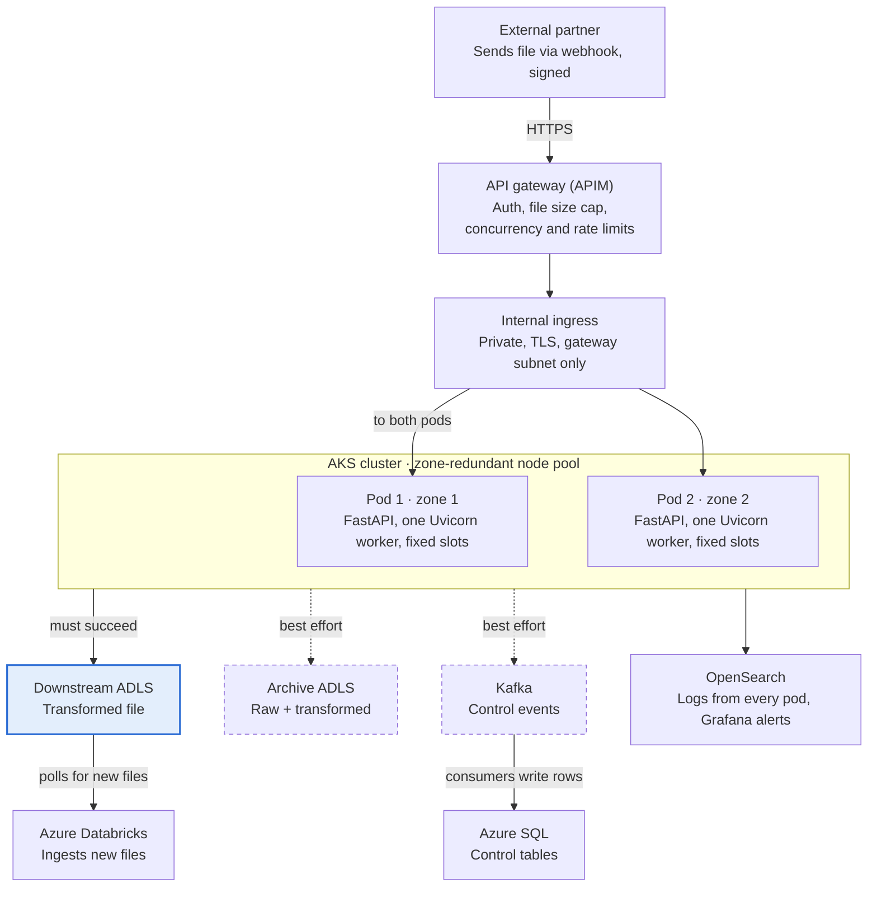
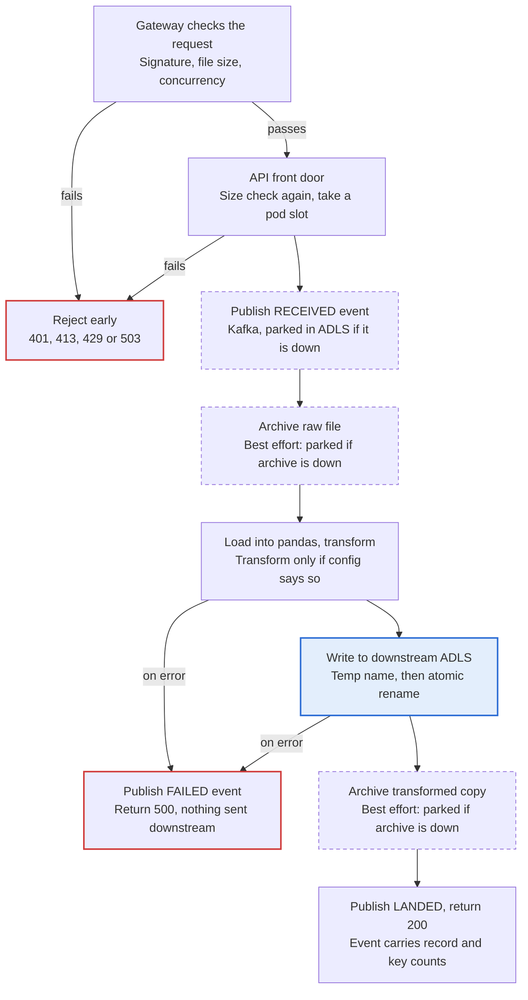
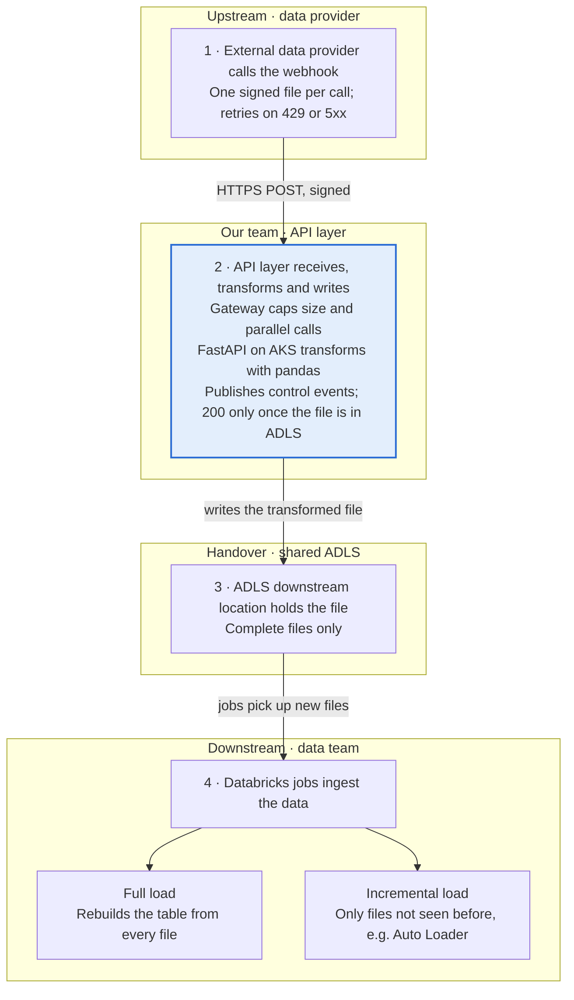

# Designing a Minimal, Highly Available Webhook File Ingestion Service on AKS

Oct 12, 2026 · Tamonash Roy

## The problem, and the short answer

An external partner pushes a file through a webhook. One API call reads it with pandas, transforms it if needed, and writes it to the ADLS location that downstream Databricks jobs watch. The short answer: **an API gateway that polices size and parallelism, two FastAPI pods on AKS that run the whole job in one call, ADLS for the files, and control events sent through Kafka to the SQL control tables.** Kafka is not new here: it is the pattern the team already uses for control tables.

**Success has exactly one meaning: the transformed file is in the downstream ADLS location.** The call returns 200 only then. Everything else, the archive copies and the control table rows, is important but secondary. If those systems are down, the work is parked and replayed later and an alert fires. They never fail the call.

The design is driven by six goals:

1. **Simple** — one API call does everything; each component has one job.
2. **One hard dependency** — only the downstream ADLS write can fail a request. SQL, Kafka and the archive degrade without blocking it.
3. **Highly available** — losing a pod or a node must not stop ingestion.
4. **Bounded memory** — pandas loads whole files, so file size and parallelism are capped at the gateway and again at the API's front door.
5. **Nothing lost** — when a secondary system is down, its work is parked and replayed, not dropped.
6. **Observable and secure** — every degraded path raises an alert; authenticated callers only, private backends, no secrets in code.

Duplicate handling is deliberately out of scope here; it happens downstream. This service only guarantees that every file is landed and counted.

## Architecture at a glance



*Solid = must succeed. Dashed = if it is down, work is parked and replayed; the call still succeeds.*

Only the gateway is public. The pods write the transformed file to downstream ADLS, where Databricks picks it up. Archive copies and control events are best effort: control events go to Kafka, and the existing consumers write them to SQL. Every pod ships its logs to OpenSearch, where Grafana watches for failures.

## How one file flows through



Bad requests die before pandas loads anything. After that, only two steps can fail the call: the transform and the downstream write. Every dashed step, the archive copies and the control events, falls back to parking its work instead of failing.

## Guardrails at the API gateway

The gateway is the memory budget's first line of defence: it rejects oversized files and excess parallel calls before a single byte reaches a pod. The examples assume Azure API Management (APIM), but any gateway with these policies works.

| Control | What it does | Response to caller |
| --- | --- | --- |
| Max file size | Reject when `Content-Length` exceeds the agreed limit; also reject requests with no `Content-Length` | 413 Payload Too Large |
| Concurrency cap | `limit-concurrency` policy caps in-flight calls to what the pods can hold (see the sizing rule below) | 429 Too Many Requests |
| Rate limit per caller | `rate-limit-by-key` on the caller's identity stops one partner starving others | 429 with `Retry-After` |
| Authentication | Subscription key plus HMAC signature or OAuth client credentials | 401 / 403 |
| Content type allow-list | Only accept the agreed formats, e.g. `text/csv`, `application/json` | 415 Unsupported Media Type |
| Timeout | Backend timeout set just above the worst-case processing time | 504 |

**Sizing the concurrency cap.** Gateway cap = replicas × concurrent slots per pod. With 2 pods and 2 slots each, the gateway allows 4 calls in flight. Keep it at or slightly below this number so the pods never queue work they cannot hold.

**Guard again at the API's front door.** Gateway counters can be per instance and approximate, so the API repeats the checks before pandas touches anything. It rejects a file over the per-source limit with 413, checking both the header and the bytes actually received. It then takes one of a fixed number of slots per pod and returns 503 when they are full. A misconfigured gateway causes a polite error, not an out-of-memory crash.

**Tell the sender how to retry.** 413 means "split the file"; 429 and 503 mean "retry with backoff". Agree this contract with the partner up front.

## FastAPI on AKS: two replicas, done properly

Two replicas is the right minimum, but only if they cannot fail together. Two pods on the same node is one point of failure with extra steps. These settings make the pair genuinely highly available:

| Setting | Value | Why |
| --- | --- | --- |
| `replicas` | 2 | Survives one pod or node loss; three adds cost without much gain at this scale |
| `topologySpreadConstraints` | Spread across nodes and availability zones | A node or zone outage takes out one pod, not both |
| Node pool | At least 2 nodes, zone-redundant | Pods need somewhere separate to land |
| `PodDisruptionBudget` | `minAvailable: 1` | Node upgrades and drains never take both pods down |
| Rolling update | `maxUnavailable: 0`, `maxSurge: 1` | Deployments keep both pods serving |
| Readiness probe | `/health/ready` checks downstream ADLS only; SQL and Kafka are left out on purpose | A pod that cannot write is taken out of rotation |
| Liveness probe | `/health/live`, lightweight | Restarts a hung process without false alarms |
| Graceful shutdown | `preStop` sleep + `terminationGracePeriodSeconds` above max processing time | In-flight files finish before the pod stops |
| Resources | Memory request = memory limit | Guaranteed QoS, so the pod is not evicted under node pressure |

**One worker per pod, a fixed number of slots.** Run a single Uvicorn worker per pod with `--limit-concurrency` set to the slot count. Scale by adding pods, not workers. This keeps the memory maths predictable and lets Kubernetes, not the process, handle restarts.

**The memory rule of thumb.** pandas typically needs several times a file's on-disk size once loaded. Size the pod as:

```latex
\text{Pod memory limit} = \text{baseline} + (\text{max file size} \times \text{expansion factor} \times \text{slots per pod})
```

Measure the expansion factor with your real files rather than guessing; it varies a lot with column types.

**HPA is optional.** If load is steady, a fixed two replicas is simpler. If load is bursty, add an HPA with `minReplicas: 2` and raise the gateway concurrency cap to match the maximum replica count.

## One API call, two ADLS locations

One webhook call runs the whole pipeline in a single pandas pass and answers only when the outcome is known. The two storage locations carry very different weight:

| Location | What lands there | Role | If the write fails |
| --- | --- | --- | --- |
| Downstream ADLS | Transformed file | Primary: Databricks polls it and ingests new files | The call fails with 500 |
| Archive ADLS | Raw file and a copy of the transformed file | Audit, debugging, reprocessing | Recorded in the control row; the call still returns 200 |

Suggested paths:

- Downstream: `<container>/<source>/<yyyy>/<mm>/<dd>/<ingestion_id>.<ext>`, in whatever format downstream expects
- Archive: `archive/<source>/<yyyy>/<mm>/<dd>/<ingestion_id>/raw/` and `.../transformed/`

**Never let Databricks see a half-written file.** It polls continuously, so it can pick up a file while it is still being written. Write to a temporary name first (Spark file sources skip names starting with `_` by default), then rename it into place. On ADLS Gen2 with hierarchical namespace enabled, the rename is atomic: downstream sees the whole file or nothing.

**Archive writes are best effort, but not lossy.** The raw file is archived right after the request is accepted, so a failed transform still leaves the original. The transformed copy is archived after the downstream write. If the archive location is down, the API parks the copy in a holding container in the downstream ADLS account, one that Databricks does not watch, and raises an alert. A sweeper job moves parked copies to the archive once it recovers. Either way, the response does not change.

**Transformation is config-driven, not code-driven.** A small source config table says, per source, whether a transform is needed and which one. Each pod loads it at startup and refreshes it on a timer, so a SQL outage never stops a file from being processed. Adding a new partner becomes a config row, not a deployment.

**Keeping pandas inside its memory budget.** pandas holds the whole file in memory, so the only reliable control is what reaches it:

- The gateway rejects oversized files and excess parallel calls.
- The API checks size again and takes a slot before reading (see the guardrails above), so a pod never holds more files than it has slots.
- FastAPI's `UploadFile` spools large uploads to disk, so the raw bytes are not held in memory alongside the DataFrame.
- Read with explicit dtypes and only the columns you need (`usecols`); inferred types cost both time and memory.
- Release the DataFrame as soon as the response is ready, so memory returns to baseline between files.

## Control tables: the audit trail

Every file gets one control row, built from events the API publishes as the file moves through the pipeline. **The API never writes to SQL directly.** It produces events to Kafka, and the existing consumers write them to Azure SQL on their regular schedule. A SQL outage delays the audit trail; it never blocks a file. Two tables are enough.

**`source_config` — one row per partner**

| Column | Purpose |
| --- | --- |
| `source_system` | Partner identifier (primary key) |
| `primary_key_columns` | Comma-separated PK columns used for counting |
| `transform_required` | Yes / no |
| `transform_name` | Which transform function to apply |
| `max_file_size_bytes` | Per-source limit, mirrored in the gateway |
| `is_active` | Switch a partner off without a deployment |

**`ingestion_control` — one row per file received**

| Column | Purpose |
| --- | --- |
| `ingestion_id` | GUID, also used in file names and as the correlation ID in logs |
| `source_system` | Links to `source_config` |
| `file_name`, `file_size_bytes`, `file_sha256` | What arrived; the checksum flags identical resends for downstream |
| `received_at`, `completed_at` | Timing, in UTC |
| `record_count` | Total rows in the file |
| `distinct_pk_count` | Distinct values of the primary key columns |
| `transform_applied` | Yes / no |
| `downstream_path` | Where the transformed file landed for Databricks |
| `status` | `RECEIVED` → `LANDED` (downstream write done) or `FAILED` |
| `raw_archive_status`, `transformed_archive_status` | `OK` or `FAILED`; never affects `status` |
| `archive_raw_path`, `archive_transformed_path` | Where the archive copies landed |
| `error_message` | Why it failed, when it did |
| `pod_name` | Which replica handled it, for troubleshooting |

`record_count` minus `distinct_pk_count` tells downstream how many duplicate keys to expect, without this service having to resolve them.

**Reconciliation is two queries.** Rows stuck in `RECEIVED` past the timeout belong to a pod that died mid-file; nothing reached downstream, so ask for a resend or reprocess from the archived raw file. Rows that are `LANDED` but have a failed archive status can be backfilled at leisure, since the business outcome already happened.

**How control events survive outages:**

1. The API publishes one event per state change (`RECEIVED`, `LANDED` or `FAILED`, plus archive status), keyed by `ingestion_id`, with an idempotent producer and `acks=all`.
2. **SQL down:** events wait in Kafka and the consumers catch up when SQL returns. Growing consumer lag is the alarm.
3. **Kafka down:** the API writes the event as a small JSON file to a holding container in the downstream ADLS account, the one dependency the call already needs, and still returns 200. A sweeper job republishes those files once Kafka is back.
4. Consumers upsert on `ingestion_id`, so replays and repeated events never create extra rows.

## Security

The gateway is the only public door; everything behind it is private and passwordless.

| Layer | Control |
| --- | --- |
| Caller identity | Subscription key per partner, plus an HMAC signature of the payload (or OAuth client credentials). Reject anything unsigned or older than a few minutes to block replays. |
| Network edge | IP allow-list for known partners; optional WAF in front of the gateway |
| Gateway to AKS | Internal ingress only, reachable from the gateway's subnet; TLS on every hop |
| Inside the cluster | Kubernetes NetworkPolicies so only the ingress can reach the pods |
| Azure services | Private endpoints for Blob, SQL and Key Vault; public access disabled |
| Secrets | None in code or config. Workload Identity for Blob and SQL; HMAC secrets in Key Vault, mounted via the CSI driver |
| Container | Non-root user, read-only root filesystem, minimal base image, image scanned in the Azure DevOps pipeline |
| Payload | Validate type, encoding and expected columns before processing; never execute or evaluate file content |
| Logs | Log the `ingestion_id` and counts, never the payload or personal data |
| Kafka | TLS plus SASL authentication; the API may only produce to its own control topic |

## Observability: hear about it before the partner does

Fallbacks are only safe if someone knows they are in use. Every degraded path in this design raises an alert, so parked work is replayed within hours, not discovered weeks later.

**Logs.** The API writes structured JSON logs, and every line carries `ingestion_id`, source, pod, stage and outcome. A log agent on the cluster (Fluent Bit, for example) ships them to OpenSearch. One `ingestion_id` search shows a file's whole journey.

**Dashboards and alerts in Grafana:**

| Signal | Alert when | What it usually means |
| --- | --- | --- |
| Downstream ADLS write failures | Any | Business impact: files are not reaching Databricks |
| 5xx responses | Above normal for several minutes | A pod, the transform or storage is failing |
| Archive writes parked in holding | Any | Archive location is down |
| Control events parked in ADLS | Any | Kafka is down |
| Kafka consumer lag on the control topic | Growing for several minutes | SQL is down or the consumers are stuck |
| Files in holding containers | Older than the agreed window | The sweeper job is not running |
| Pod memory close to its limit, or OOMKilled | Any | File size or slot settings are too generous |
| 413 and 429 responses | Sudden spike | A partner is sending bigger or more files than agreed |

## What happens when things break

Every failure either gives the sender a clear retry signal or parks the work for replay. Only a failed transform or downstream write ever reaches the sender as an error.

| Failure | What the system does | Sender sees |
| --- | --- | --- |
| One pod crashes | Other pod keeps serving; Kubernetes restarts the crashed one | Nothing, or one retryable 502 for the in-flight call |
| A node or zone goes down | Topology spread means the other pod is elsewhere | Nothing |
| File too large | Gateway, or the API's front door, rejects it before pandas loads it | 413 |
| Too many parallel calls | Gateway, and then the API's slots, refuse the excess | 429 / 503, retry with backoff |
| SQL unreachable | Events wait in Kafka; consumers catch up later; lag alert fires | 200 |
| Kafka unreachable | Events parked as files in ADLS; sweeper republishes; alert fires | 200 |
| Archive ADLS unreachable | Copies parked in a holding container; sweeper moves them; alert fires | 200 |
| Transform fails | `FAILED` event published; raw file is in the archive or holding area | 500; fix and reprocess, or ask for a resend |
| Downstream ADLS write fails | Temporary file never renamed, so Databricks sees nothing; `FAILED` event published | 500, retry |
| Pod dies mid-file | Temporary file never renamed; control row stays `RECEIVED` | Timeout; resend |
| Partner resends the same file | Lands again with a new `ingestion_id`; same checksum | 200; downstream deduplicates |

## Why we chose to build it this way

Every decision below trades a little elegance for fewer moving parts in the request path, and says out loud what it gives up.

| Decision | Why | What we accept |
| --- | --- | --- |
| One synchronous API call does everything | Simplest to build and debug; the sender gets a definite answer | Processing time is bounded by the gateway timeout |
| Size and concurrency capped at the gateway and the API | pandas memory stays predictable, so pods are not OOM-killed | Partners must split very large files |
| Two replicas spread across zones | Survives a pod, node or zone loss at minimal cost | Bursts beyond the slot count get 429 until an HPA is added |
| Only the downstream ADLS write can fail the call | It is the business outcome Databricks depends on | Archive and audit trail can lag behind the data |
| Control rows via Kafka, never direct SQL | Reuses the team's existing pattern; a SQL outage never blocks a file | The control table is eventually consistent |
| Source config cached in each pod | Processing does not depend on SQL being up | A config change takes one refresh cycle to apply |
| Downstream ADLS account as last-resort parking | Uses the one dependency the call already needs; no new component | A sweeper job must run and be monitored |
| Files only become visible when complete | Databricks never ingests half a file | One extra step per write |
| Duplicates handled downstream | Keeps the API stateless and simple | Downstream must deduplicate on the primary key |
| Logs in OpenSearch, alerts in Grafana | Every fallback is visible, so nothing parked is forgotten | More alerts to tune |

In one line: **police at the edge, do the work in one call, protect the one write that matters, and park everything else rather than fail.** Start this simple; add a queue for the data itself, an HPA or a third replica only when real traffic shows you need them.

*How do you handle webhook file ingestion in your stack? I'd like to hear what has worked for you.*

## End to end: who does what



The data provider only pushes; Databricks only pulls. ADLS is the contract between them: once a complete file sits in the downstream location, our job is done, and the data team decides whether to load it fully or incrementally.
